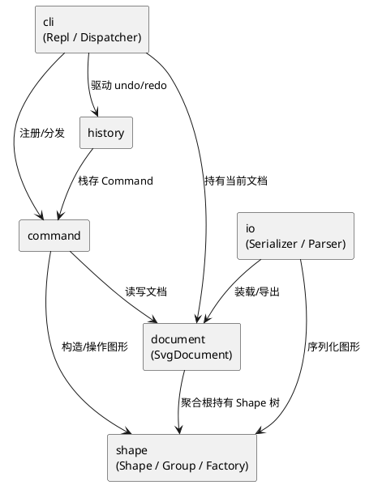

# SVG 编辑器 CLI — 架构方案

项目地址：
git@github.com:Mengxi-Xu/fd-svg-editor.git


## 1. 模块划分

工程按"领域内核 → 命令控制 → 表现层"自下而上分层，每个模块单一职责：

| 模块（目录） | 职责 | 内容 |
|---|---|---|
| `src/shape/` | 图形领域模型（Composite：`Shape` 抽象、叶子图形、`Group` 容器、`ShapeFactory`） | Shape / LeafShape / Rect / Circle / Ellipse / Line / Text / Group / ShapeFactory |
| `src/document/` | 文档聚合根 `SvgDocument`：画布尺寸、根 Shape 列表、id 注册表 | SvgDocument |
| `src/io/` | SVG 序列化/解析，IO 隔离 | SvgSerializer / SvgParser |
| `src/command/` | Command 模式：`Command` 接口、各命令实现 | Command 接口 + 17 个命令 |
| `src/history/` | undo/redo 历史栈 | CommandHistory |
| `src/cli/` | REPL 主循环、命令分发、`HelpCommand` | Repl / CommandDispatcher / HelpCommand |

入口 `src/index.ts` 在 `src/` 根，仅组装 Repl，不归属任何模块。

### 组件图



## 2. 设计模式的选择

- **Command**（`src/command/`）：每条命令一个类，实现 `execute/undo/redo`。把每次编辑封装成对象，天然支持 undo/redo；REPL 只负责解析与分发，不关心命令内部。`category` 字段（`Edit | Display | Document`）决定是否进入 undo 栈：`Edit` 入栈、`Display` 跳过、`Document` 执行后禁止 undo/redo（对应作业 4.3 粒度规则）。
- **Composite**（`src/shape/`）：`Shape` 统一接口，`Group` 容器与叶子图形同构。`move/scale/set/delete` 对容器与叶子一视同仁，递归操作由容器负责。容器方法 `getChildren/addChild/removeChild/indexOfChild/insertChildAt` 在叶子默认抛 `not a container`，`Group` 重写。
- **Factory**（`src/shape/ShapeFactory`）：类型名 → 类。`create` 命令按字符串类型构造图形，是作业允许的"按名字分派"两处之一。

**Command 接口**（`src/command/Command.ts`）：

```typescript
export interface Command {
  readonly kind: string;
  readonly category: CommandCategory; // Edit | Display | Document
  execute(): CommandResult;
  undo(): CommandResult;
  redo(): CommandResult;
}
```

## 3. 依赖方向规则

允许的依赖（自下而上）：

- `shape` → 无。纯领域模型，不依赖任何上层。
- `document` → `shape`。聚合根持有 Shape 树。
- `io` → `document`、`shape`。装载/导出需要读写文档与图形。
- `command` → `document`、`shape`、`io`。命令操作文档与图形，Read/Save 用 io。
- `history` → `command`（仅类型）。栈中存放 Command 对象。
- `cli` → `command`、`history`、`document`、`shape`、`io`。表现层组装一切。

**禁止的依赖**（违反即为待处理项）：

- `shape` → 任何上层（领域不依赖控制/表现）
- `document` → `cli` / `command` / `history`（聚合根不依赖表现与控制）
- `command` → `cli`（命令不依赖 REPL）
- `command` → `history`（元命令不直接访问历史栈，由 Dispatcher 编排，见过程记录提交 5）
- `io` → `cli` / `command` / `history`（IO 不依赖控制层）

## 4. 变化点假设

1. **新增图形类型**（如 `box` 复合图形，见作业 4.4）：留 `ShapeFactory` + 后续 `ShapeProvider` 插槽；本阶段 `create box` 报 `unknown shape type`，插件化阶段零改内核。
2. **新增命令**：留 Command 接口 + 分发注册表，新命令只需实现接口并在 Dispatcher 注册。
3. **IO 格式变化**（如读写 PNG 预览）：留 `src/io/` 隔离，序列化/解析不渗入领域。
4. **交互通道扩展**（agent / 鼠标）：命令层与 REPL 分离，同一套 Command 可被非 REPL 通道复用。
5. **undo 策略**（如宏命令合并）：不留——当前"一条编辑 = 一个单元"足够，过度设计无收益。

---

## 过程记录

记录关键、有代表性的讨论与迭代过程，重点是"从 AI 给的建议、生成的文档或代码中发现了什么问题、如何确认并纠正"。

### 提交 1：工程骨架与核心抽象

- **命名 `SvgDocument` 而非 `Document`**：AI 初版建议沿用 `Document` 类名。发现该名与 DOM 全局 `Document` 混淆，且 TS 里易触发 lib.dom 类型冲突。纠正为 `SvgDocument`，同时遵循"一类一文件、文件名 = 类名"约定（`SvgDocument.ts`）。
- **Command 接口引入 `category` 字段**：作业 4.3 要求文档类命令后禁止 undo/redo、显示类不入栈。AI 初版想在 Dispatcher 里用 `switch(kind)` 判断每条命令的栈语义，这会让 Dispatcher 充满命令名硬编码、新增命令必改 Dispatcher。纠正为在 Command 接口加 `category: CommandCategory` 枚举，命令自述其栈语义，Dispatcher 只按枚举分派。
- **REPL 提交 1 仅注册 `help`**：其余命令统一回 `error: unknown command`，保证骨架可启动、可编译，为提交 2 起的命令落地留出分发入口。

### 提交 2：图形体系 + 文档命令 + create/tree/show

- **Composite 落地**：`LeafShape` 基类统一处理公共属性 `fill/stroke/stroke-width`，子类只实现几何（`geomAttrs/moveGeom/scaleGeom/setGeom`）；`Group` 对 `move/scale` 递归到子节点。容器与叶子共享 `Shape` 接口。
- **SvgParser 嵌套同名标签的闭合匹配**：AI 初版用"找下一个 `</tag>`"定位闭合标签。用 `examples/other.svg`（含嵌套 `<g id="g1">`）测试时发现 `tree` 输出结构错乱——内层 `</g>` 被当成外层闭合。确认问题后纠正为 `findCloseTag` 深度计数：遇到同名开标签 `depth++`、闭标签 `depth--`，`depth=0` 时返回真正匹配的闭合位置。这是"用测试用例确认 AI 生成代码缺陷"的典型一例。
- **IO 隔离**：`SvgParser` 手写递归下降解析器，缺 id 元素按 `标签名+序号` 自动补并打印 `warning: assigned id ...`；`SvgSerializer` 调各 `Shape.toSvg` 生成标准 SVG。IO 不渗入领域。
- **`create` 的 `in` 子句**：创建时即表达归属，对应作业"三种时机"中的"创建时归属"；`group`/`addto` 留给提交 3 处理事后收编与移动归属。

### 提交 3：编辑命令族

- **move/scale 对容器：transform 属性 vs 递归改坐标**：AI 建议用 SVG `transform="translate(dx,dy)"` 表达容器平移，更简洁且符合 SVG 语义。发现两个问题：(a) 作业 4.1 明确"作用于容器时递归到每个子孙"；(b) 用 transform 后 `tree`/`show` 显示的子坐标是变换前的局部坐标，与"看到即真实坐标"的调试预期不符。确认方法：对照作业 6.1 `move node2 0 100` 后 `tree` 应显示 `process y=200`（而非 y=100 + 一个 transform）。纠正为递归改子节点坐标，序列化输出平铺绝对坐标。代价是容器平移后子坐标被改写，但符合作业明确要求且调试直观。
- **`group` 与 `in` 子句的时机划分**：`create ... in <c>`（创建时归属）、`group <g> <ids>`（事后收编已存在图形）、`addto <g> <id>`（移动归属）三者各司其职，命令层不混用。
- **`group` 含容器与其子孙的检查方向**：AI 初想"判断 shape A 是否在 shape B 的子树里"（递归向下遍历 B 的子孙）。发现反向更简单：对每个待收编图形沿 `parent` 链向上，若遇到另一个待收编图形即报错。O(树深) 且无需遍历子树，且错误信息天然指向那个祖先容器 id，符合作业示例 `group bad c1 markers → error: ...: markers`。确认方法：回放作业该错误用例，输出 `cannot group a container into its own descendant: markers` 完全一致。
- **`SvgDocument` 细粒度 API**：新增 `detach/attachRoot/attachRootAt/registerId/unregisterId`，与原有递归 `register/unregister`（用于 create/delete 整棵子树）分离。`group/ungroup/addto/front/back` 只移动子树不改变 id 集合，用细粒度 API 避免误注销被移动图形的 id。这是在写 `group` 时发现"递归 unregister 会把被移动图形的 id 一起删掉"才引入的拆分。
- **`set` 的 undo 与属性清除**：原本无 `fill` 的图形执行 `set fill red` 后 undo，AI 初版用 `setAttr(attr, oldValue)`，但 oldValue 是 `undefined`，`setAttr` 不接受 undefined，属性会残留。确认方法：`set` 后 `undo` 再 `show`，fill 仍在。纠正：加 `clearAttr` 方法，undo 时若旧值 undefined 调 `clearAttr` 移除属性，否则恢复旧值。几何属性必填不会走清除分支。

### 提交 4：undo/redo 历史栈

- **`CommandHistory` 双栈 + frozen**：`undoStack`/`redoStack` + `frozen` 标志。`push`（编辑命令）入 undo 栈、**清空 redo 栈**、解冻；`onReset`（init/read）清两栈并冻结（文档已变，旧编辑无意义）；`onIo`（save / canvas 改尺寸）仅冻结不清栈（文档内容未变，只是暂时禁止 undo）。
- **粒度落地**：一条编辑命令 = 一个 undo 单元；文档类命令后 `frozen=true`，`undo`/`redo` 报 `undo not allowed after io command`，下一次编辑命令 `push` 解冻。
- **CanvasCommand category 静态 vs 动态**：AI 初版把 `category` 静态设为 `Document`。发现 `canvas` 无参数是纯查询，不该冻结 undo 栈（否则 `canvas` 看一眼尺寸后就无法 undo 之前的编辑）。确认方法：`move → canvas → undo` 应能撤销 move。纠正：构造时根据 `args.length` 设 category——无参数 `Display`（不入栈不冻结），有参数 `Document`（onIo 冻结）。
- **Dispatcher 按 category 编排历史**：`Edit` → push；`Document` → onReset/onIo；`Display` → 跳过。**失败命令（`result.ok=false`）不触碰历史**，保证"命令失败不改变任何状态"延伸到历史层。
- **redo 栈清空时机**：作业 4.3"undo 后若有新编辑，redo 栈清空"由 `push` 中 `redoStack.length = 0` 实现，已用 `undo → create → redo(nothing to redo)` 验证。

### 提交 5：一致性自查与定稿

- **自查发现 `command↔history` 循环依赖**（本次最关键的纠正）：提交 4 为求 Command 接口统一，把 undo/redo 做成 `UndoCommand`/`RedoCommand`（command 模块），它们 import `CommandHistory`，而 `CommandHistory` import `Command`，形成循环，违反架构方案"command → history 禁止"。**确认方法**：一致性自查时 `grep "CommandHistory" src/command` 命中两个文件，暴露违规。**纠正**：权衡后选择消除循环（架构整洁优先于接口统一），删除两个元命令类，undo/redo 改为 Dispatcher 内联 `handleUndo/handleRedo`。重构后重新回放第 6 节完整会话，undo/redo 行为逐行不变，确认重构无功能回归。这是"先定架构契约、再自查对照、发现偏离即纠正"方法的直接产出。
- **分派点仅两处确认**：命令分发（`Dispatcher.build` 的 switch）+ 图形工厂（`ShapeFactory.create` 的 switch），符合作业"按名字分派只允许两处"。`undo`/`redo` 不走 `build`（Dispatcher 单独处理），不计入分派点。

## 一致性自查

### 1. 模块划分

实际目录与架构方案完全一致：

| 方案模块 | 实际目录 | 内容 |
|---|---|---|
| shape | `src/shape/` | Shape / LeafShape / Rect / Circle / Ellipse / Line / Text / Group / ShapeFactory |
| document | `src/document/` | SvgDocument |
| io | `src/io/` | SvgSerializer / SvgParser |
| command | `src/command/` | Command 接口 + 17 个命令实现 |
| history | `src/history/` | CommandHistory |
| cli | `src/cli/` | Repl / CommandDispatcher / HelpCommand |

入口 `src/index.ts` 在 `src/` 根，仅组装 Repl，不归属任何模块。

### 2. 依赖方向

方案规则执行情况（grep 抽样检查，全部无匹配即无违规）：

- shape 不依赖上层：`grep "from '\.\./" src/shape` → 无匹配 ✓
- document 不依赖 cli/command/history：`grep "from '\.\./(cli\|command\|history)" src/document` → 无匹配 ✓
- command 不依赖 cli：`grep "from '\.\./cli" src/command` → 无匹配 ✓
- command 不依赖 history：`grep "CommandHistory" src/command` → 无匹配 ✓
- io 不依赖 cli/command/history：`grep "from '\.\./(cli\|command\|history)" src/io` → 无匹配 ✓

**修订记录**：提交 4 曾引入 `UndoCommand`/`RedoCommand`（command→history）造成循环，提交 5 重构消除。最终依赖图无环：`cli → {command, history, document, shape, io}`，`history → command`（仅类型），`command → {document, shape, io}`，`document → shape`，`io → {document, shape}`，`shape → ∅`。

## 质量保证手段

### 方法论：先架构文档，后分步编码

对"如何确认最终代码功能完整、对代码质量有足够信心"，核心做法是**先用 AI 生成完整的功能架构文档，再让 AI 一部分一部分地写代码**，降低 AI 写代码的随机性、提升一致性：

1. **先定契约**：第一步让 AI 只产出本文档第 1–4 节（模块划分、组件图、设计模式、依赖方向、变化点假设），不写任何业务代码。这份文档明确了模块边界、允许的依赖、分派点位置、变化点预留，作为后续所有编码的约束。
2. **分步填充**：第二步让 AI 按 `commit_plan.md` ，每次只写一个主题（骨架 → 图形+文档命令 → 编辑命令族 → undo/redo → 自查定稿），写完立即 `tsc --noEmit` + 会话回放验证。
3. **效果**：架构文档把 AI 的随机性限制在单模块内——每次只在契约里填代码，模块边界与依赖方向已定，不会前后不一致；分步提交让每步可独立验证，偏离能被及早发现。典型例证：提交 4 引入的 `command↔history` 循环依赖，在提交 5 一致性自查时被 `grep` 抓出并纠正。若一次性让 AI 写完所有代码，模块边界、命名、依赖方向容易前后不一，且错误难以定位。

### 验证清单

- **类型检查**：`tsc --noEmit` 零错误（`strict` + `noImplicitOverride` + `noUnusedLocals/Parameters` + `noFallthroughCasesInSwitch`）。每次提交后都跑，类型即第一道防线。
- **第 6 节完整会话回放**：`init / create(4 种) / group / tree / move / undo / redo / set / delete / undo / save / undo(禁止) / read / tree` 逐行与作业预期一致。这是功能完整性的主证据——作业给出的标准 transcript 能完整复现。
- **6.1 流程图案例**：`in` 子句自顶向下构建 + `move` 容器整体平移 + `set text` + `group bad` 报错 + `delete` + `addto` + `ungroup`（子节点提升）+ `scale`（位置尺寸同乘）+ `front/back` z-order 全部正确。覆盖 Composite 统一操作语义。
- **4.3 粒度规则**：`undo→create→redo` 报 `nothing to redo`（redo 栈清空）；`save→redo` 报 `redo not allowed after io command`（冻结）；`create` 后 `undo` 正常（编辑解冻）。覆盖 undo/redo 边界。
- **Command 模式落地**：每条编辑命令实现 `execute/undo/redo`；Dispatcher 按 `category` 编排历史（Edit 入栈 / Document 冻结 / Display 跳过）；失败命令不触碰历史。
- **Composite 落地**：`Group` 与叶子统一 `move/scale/set/delete`；`tree`/`show` 对两者一致；`group/ungroup/addto` 保持 id 集合不变（细粒度 API）。
- **边界用例**：id 重复/不存在、`unknown shape type`、`scale` 非正数、`group` 含容器子孙、`ungroup` 根级容器/叶子、`in` 目标不存在/非容器、IO 命令后 undo 禁止——均有对应 `error:` 信息，命令失败不改变状态。
- **依赖方向 grep 校验**：每次涉及 import 的改动后，grep 确认无跨层依赖（见一致性自查第 2 节的 5 条检查）。
