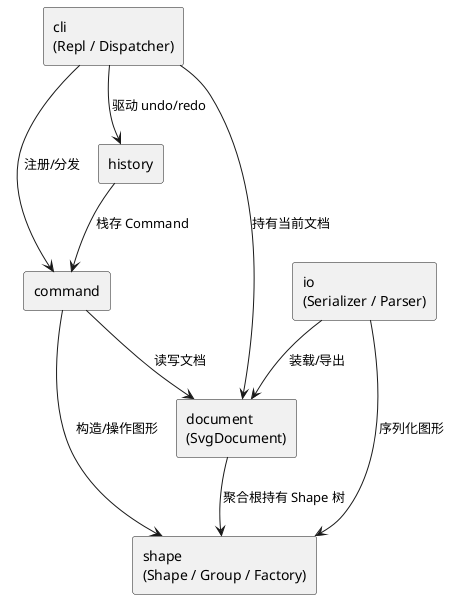

# SVG 编辑器 CLI — 架构方案

> Lab1 Phase 1。本文件随提交增量更新，当前对应**提交 1：工程骨架与核心抽象**。

## 1. 模块划分

工程按"领域内核 → 命令控制 → 表现层"自下而上分层，每个模块单一职责：

| 模块（目录） | 职责 | 当前状态 |
|---|---|---|
| `src/shape/` | 图形领域模型（Composite：`Shape` 抽象、叶子图形、`Group` 容器、`ShapeFactory`） | 抽象基类已建，具体图形待提交 2 |
| `src/document/` | 文档聚合根 `SvgDocument`：画布尺寸、根 Shape、id 注册表 | 骨架已建 |
| `src/io/` | SVG 序列化/解析，IO 隔离 | 待提交 2 |
| `src/command/` | Command 模式：`Command` 接口、各命令实现 | 接口已建，命令待提交 2-4 |
| `src/history/` | undo/redo 历史栈 | 待提交 4 |
| `src/cli/` | REPL 主循环、命令分发、`HelpCommand` | REPL + help 已建 |

### 组件图



## 2. 设计模式的选择

| 模式 | 落地位置 | 作用 |
|---|---|---|
| **Command** | `src/command/`：每条命令一个类，实现 `execute/undo/redo` | 把每次编辑封装成对象，天然支持 undo/redo；REPL 只负责解析与分发，不关心命令内部 |
| **Composite** | `src/shape/`：`Shape` 统一接口，`Group` 容器与叶子图形同构 | `move/scale/set/delete` 对容器与叶子一视同仁，递归操作由容器负责 |
| **Factory** | `src/shape/ShapeFactory`：类型名 → 类 | `create` 命令按字符串类型构造图形，是作业允许的"按名字分派"两处之一 |

**Command 接口**（`src/command/Command.ts`）：

```typescript
export interface Command {
  readonly kind: string;
  readonly category: CommandCategory; // Edit | Display | Document
  execute(): CommandResult;
  undo(): CommandResult;
  redo(): CommandResult;
}
```

`category` 决定是否进入 undo 栈：`Edit` 入栈、`Display` 跳过、`Document` 执行后禁止 undo/redo（对应作业 4.3 粒度规则）。

## 3. 依赖方向规则

| 模块 | 允许依赖 | 理由 |
|---|---|---|
| `shape` | （无） | 纯领域模型，不依赖任何上层 |
| `document` | `shape` | 聚合根持有 Shape 树 |
| `io` | `document`, `shape` | 装载/导出需要读写文档与图形 |
| `command` | `document`, `shape` | 命令操作文档与图形 |
| `history` | `command` | 栈中存放 Command 对象 |
| `cli` | `command`, `history`, `document` | 表现层组装一切 |

**禁止的依赖**（违反即为待处理项）：
- `shape` → 任何上层（领域不依赖控制/表现）
- `document` → `cli` / `command`（聚合根不依赖表现与控制）
- `command` → `cli`（命令不依赖 REPL）
- 任何模块 → `history`（除 `cli`）（历史栈只被表现层驱动）

## 4. 变化点假设

| # | 可能变化 | 留了什么 / 为何不留 |
|---|---|---|
| 1 | **新增图形类型**（如 `box` 复合图形，见作业 4.4） | 留 `ShapeFactory` + 后续 `ShapeProvider` 插槽；本阶段 `create box` 报 `unknown shape type`，插件化阶段零改内核 |
| 2 | **新增命令** | 留 Command 接口 + 分发注册表，新命令只需实现接口并在 Dispatcher 注册 |
| 3 | **IO 格式变化**（如读写 PNG 预览） | 留 `src/io/` 隔离，序列化/解析不渗入领域 |
| 4 | **交互通道扩展**（agent / 鼠标） | 命令层与 REPL 分离，同一套 Command 可被非 REPL 通道复用 |
| 5 | **undo 策略**（如宏命令合并） | 不留：当前"一条编辑 = 一个单元"足够，过度设计无收益 |

---

## 过程记录

（随提交增量补充。当前为提交 1，记录骨架阶段的决策。）

- **命名 `SvgDocument` 而非 `Document`**：避免与 DOM 全局 `Document` 混淆，同时遵循"一类一文件、文件名 = 类名"约定（`SvgDocument.ts`）。
- **Command 接口引入 `category` 字段**：作业 4.3 要求文档类命令后禁止 undo/redo、显示类不入栈，用枚举显式表达三类命令的栈语义，避免在 Dispatcher 里用 `switch(kind)` 判断。
- **REPL 提交 1 仅注册 `help`**：其余命令统一回 `error: unknown command`，保证骨架可启动、可编译，为提交 2 起的命令落地留出分发入口。

### 提交 2：图形体系 + 文档命令 + create/tree/show

- **Composite 落地**：`LeafShape` 基类统一处理公共属性 `fill/stroke/stroke-width`，子类只实现几何（`geomAttrs/moveGeom/scaleGeom/setGeom`）；`Group` 对 `move/scale` 递归到子节点。容器与叶子共享 `Shape` 接口，`getChildren/addChild/removeChild` 在叶子默认抛 `not a container`，`Group` 重写。
- **IO 隔离**：`SvgParser` 手写递归下降解析器（标签栈 + 自闭合/嵌套同名标签计数），缺 id 元素按 `标签名+序号` 自动补并打印 `warning: assigned id ...`；`SvgSerializer` 调各 `Shape.toSvg` 生成标准 SVG。IO 不渗入领域。
- **`create` 的 `in` 子句**：创建时即表达归属，对应作业"三种时机"中的"创建时归属"；`group`/`addto` 留给提交 3 处理事后收编与移动归属。

### 提交 3：编辑命令族

- **容器统一操作语义**：`move/scale` 对容器递归改子节点坐标（而非用 SVG `transform` 属性），序列化输出平铺的绝对坐标。这样 `tree`/`show` 看到的坐标即真实坐标，调试直观；代价是容器平移后子坐标被改写，但符合作业 4.1"作用于容器时递归到每个子孙"的明确要求。
- **`group` 与 `in` 子句的时机划分**：`create ... in <c>`（创建时归属）、`group <g> <ids>`（事后收编已存在图形）、`addto <g> <id>`（移动归属）三者各司其职，命令层不混用。
- **`SvgDocument` 细粒度 API**：新增 `detach/attachRoot/attachRootAt/registerId/unregisterId`，与原有递归 `register/unregister`（用于 create/delete 整棵子树）分离。`group/ungroup/addto/front/back` 只移动子树不改变 id 集合，用细粒度 API 避免误注销被移动图形的 id。
- **`group` 含容器与其子孙的检查**：对每个待收编图形沿 `parent` 链向上，若链上遇到另一个待收编图形即报 `cannot group a container into its own descendant`，错误信息指向那个祖先容器 id（与作业示例 `group bad c1 markers → ...: markers` 一致）。
- **`set` 的 undo 与属性清除**：记录旧值（`string | undefined`），undo 时若旧值为 `undefined` 调 `clearAttr` 移除属性（如原本无 `fill` 的图形被 `set fill` 后 undo），否则恢复旧值。几何属性必填不会走清除分支。

### 提交 4：undo/redo 历史栈

- **`CommandHistory` 双栈 + frozen**：`undoStack`/`redoStack` + `frozen` 标志。`push`（编辑命令）入 undo 栈、**清空 redo 栈**、解冻；`onReset`（init/read）清两栈并冻结（文档已变，旧编辑无意义）；`onIo`（save / canvas 改尺寸）仅冻结不清栈（文档内容未变，只是暂时禁止 undo）。
- **粒度落地**：一条编辑命令 = 一个 undo 单元；文档类命令后 `frozen=true`，`undo`/`redo` 报 `undo not allowed after io command`，下一次编辑命令 `push` 解冻。`canvas` 无参数是纯查询（构造时 `category=Display`），不冻结、不入栈。
- **`UndoCommand`/`RedoCommand` 为元命令**：`category=Display` 自身不入栈，`execute` 从 history 取出目标命令并转发其 `undo()`/`redo()` 结果，故 REPL 输出的就是被撤销命令的反馈（如 `circle#c1 moved back to (100,100)`）。
- **Dispatcher 按 category 编排历史**：`Edit` → push；`Document` → onReset/onIo；`Display` → 跳过。**失败命令（`result.ok=false`）不触碰历史**，保证"命令失败不改变任何状态"延伸到历史层。
- **redo 栈清空时机**：作业 4.3"undo 后若有新编辑，redo 栈清空"由 `push` 中 `redoStack.length = 0` 实现，已用 `undo → create → redo(nothing to redo)` 验证。

## 一致性自查

（提交 5 完成。当前阶段：骨架与方案一致。）

## 质量保证手段

（提交 5 完成。当前阶段：`tsc --noEmit` 通过 + `help` 可运行。）
